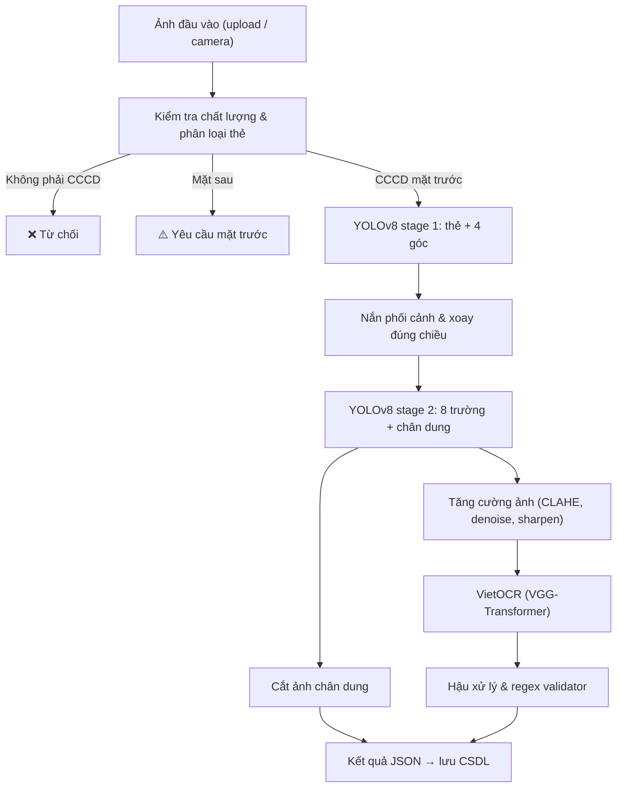

# 🪪 CCCD OCR — Trích xuất thông tin Căn cước công dân Việt Nam

<div align="center">


Hệ thống nhận diện và trích xuất tự động **8 trường thông tin** trên mặt trước thẻ CCCD gắn chip,
gồm pipeline **YOLOv8 hai giai đoạn + VietOCR**, quét trực tiếp bằng camera, quản lý hồ sơ và thẩm định độ chính xác bằng AI.

[Tính năng](#-tính-năng) • [Pipeline](#-pipeline-xử-lý) • [Cài đặt](#-cài-đặt) • [API](#-api) • [Cấu trúc](#-cấu-trúc-thư-mục) • [Tài liệu](#-tài-liệu)

</div>

---

## ✨ Tính năng

| Nhóm | Mô tả |
|---|---|
| **Nhận diện** | Phát hiện thẻ + 4 góc (YOLOv8 stage 1), nắn phối cảnh, tự xoay đúng chiều (0°/90°/180°/270° và ảnh nghiêng) |
| **Trích xuất** | Định vị 8 trường (YOLOv8 stage 2) → tăng cường ảnh (CLAHE, khử nhiễu, làm nét) → VietOCR → chuẩn hóa & kiểm tra bằng regex |
| **Ảnh chân dung** | Tự động cắt ảnh chân dung chủ thẻ |
| **Camera** | Quét trực tiếp qua trình duyệt (WebRTC), kiểm tra thời gian thực: ✅ CCCD mặt trước / ⚠️ mặt sau / ❌ không phải CCCD; tự chụp khi thẻ ổn định hoặc bấm <kbd>Space</kbd> |
| **Quản lý** | Đăng ký / đăng nhập JWT, lịch sử quét, sửa / xóa kết quả, xuất PDF |
| **Thống kê** | Tổng quan lượt quét, nhân khẩu học (giới tính, tỉnh thành, độ tuổi), chất lượng AI theo từng trường |
| **AI Oracle** | Đối chiếu kết quả OCR với Gemini / OpenAI để chấm độ chính xác (tùy chọn, cần API key) |

**8 trường trích xuất:** Số CCCD · Họ và tên · Ngày sinh · Giới tính · Quốc tịch · Quê quán · Nơi thường trú · Có giá trị đến.

---

## 🏗️ Pipeline xử lý



Chi tiết từng bước: [`docs/reports/PIPELINE_DOCUMENTATION.md`](docs/reports/PIPELINE_DOCUMENTATION.md).

---

## 🧰 Công nghệ

| Thành phần | Công nghệ |
|---|---|
| Phát hiện đối tượng | Ultralytics YOLOv8 (2 model tự huấn luyện) |
| OCR | VietOCR — VGG-Transformer |
| Xử lý ảnh | OpenCV, Pillow, NumPy |
| Backend | FastAPI, Uvicorn, SQLAlchemy, PyJWT, bcrypt |
| CSDL | PostgreSQL (qua Docker) hoặc **SQLite tự động** khi không có PostgreSQL |
| Frontend | React 19 + Vite, jsPDF |

---

## 🚀 Cài đặt

### Yêu cầu
- Python **3.9+**
- Node.js **18+** (chỉ cần nếu build lại frontend)
- RAM ≥ 4 GB (khuyến nghị 8 GB)
- Docker (tùy chọn, để chạy PostgreSQL)

### 1. Clone & tạo môi trường ảo

```bash
git clone https://github.com/vminh21/OCR_CCCD-yolov8-.git
cd OCR_CCCD-yolov8-

python3 -m venv .venv
source .venv/bin/activate        # Windows: .venv\Scripts\activate
pip install --upgrade pip
pip install -r requirements.txt
```

### 2. Cấu hình biến môi trường

```bash
cp .env.example .env
```

| Biến | Bắt buộc | Ý nghĩa |
|---|---|---|
| `DATABASE_URL` | Không | Chuỗi kết nối PostgreSQL. Bỏ trống hoặc không kết nối được → tự dùng SQLite `ocr_cccd.db` |
| `JWT_SECRET_KEY` | **Nên đổi** | Khóa ký token đăng nhập |
| `GEMINI_API_KEY` / `OPENAI_API_KEY` | Không | Bật tính năng AI Oracle thẩm định độ chính xác |
| `ROBOFLOW_API_KEY` | Không | Chỉ dùng cho `download_data.py` khi tải dataset để huấn luyện |

> ⚠️ Không bao giờ commit file `.env` — file này đã nằm trong `.gitignore`.

### 3. Trọng số model

Hai model YOLOv8 đã có sẵn trong repo:

```text
weights/
├── yolov8_cccd_detect.pt   # Stage 1: phát hiện thẻ & 4 góc
└── yolov8_fields.pt        # Stage 2: phát hiện 8 trường + chân dung
```

Trọng số VietOCR được tải tự động ở lần chạy đầu tiên (hoặc đặt sẵn tại `weights/vgg_transformer.pth`).

### 4. (Tùy chọn) Chạy PostgreSQL bằng Docker

```bash
docker compose up -d
```

- PostgreSQL: `localhost:5432` — schema khởi tạo từ `docker/init.sql`
- pgAdmin: <http://localhost:5050>

### 5. Khởi động

```bash
./run.sh            # tự build frontend nếu chưa có, giải phóng cổng 8000, rồi chạy server
# hoặc
python3 main.py
```

Mở trình duyệt tại **<http://localhost:8000>**.

> 📷 Dùng `localhost` hoặc `127.0.0.1`, **không** dùng `0.0.0.0` — trình duyệt sẽ chặn camera trên địa chỉ không bảo mật.

**Tài khoản demo (chỉ cho môi trường local):** `minh_final` / `password123` — được tạo tự động ở lần chạy đầu. Có thể đăng ký tài khoản mới ngay trên giao diện.

### Phát triển frontend

```bash
cd frontend
npm install
npm run dev         # http://localhost:5173, proxy /api, /predict, /media → :8000
npm run build       # build vào frontend/dist (backend tự phục vụ bản build này)
```

---

## 🔌 API

Tài liệu tương tác (Swagger) có tại **<http://localhost:8000/docs>** khi server đang chạy.

| Method | Endpoint | Mô tả |
|---|---|---|
| `POST` | `/api/auth/register` | Đăng ký |
| `POST` | `/api/auth/login` | Đăng nhập, trả JWT |
| `POST` | `/api/auth/logout` | Đăng xuất |
| `POST` | `/api/auth/change-password` | Đổi mật khẩu |
| `GET` | `/api/auth/me` | Thông tin người dùng hiện tại |
| `POST` | `/predict/image` | Trích xuất thông tin từ ảnh / video |
| `POST` | `/predict/camera-probe` | Kiểm tra khung hình camera theo thời gian thực |
| `GET` | `/predict/evaluate-status` | Trạng thái cấu hình API key AI Oracle |
| `POST` | `/predict/evaluate-test-key` | Kiểm tra API key |
| `POST` | `/predict/evaluate-on-demand` | Thẩm định độ chính xác một kết quả |
| `GET` | `/api/history` | Lịch sử quét |
| `GET` | `/api/results` | Danh sách kết quả CCCD |
| `GET / PUT / DELETE` | `/api/results/{id}` | Xem / sửa / xóa một kết quả |
| `GET` | `/api/statistics` | Thống kê tổng quan |
| `GET` | `/api/statistics/demographics` | Thống kê nhân khẩu học |
| `GET` | `/api/statistics/ai-quality` | Chất lượng AI theo từng trường |
| `GET` | `/api/corrections` | Lịch sử đánh giá & chỉnh sửa |

---

## 🗂️ Cấu trúc thư mục

```text
OCR_CCCD-yolov8-/
├── backend/                  # Ứng dụng FastAPI (mã nguồn chính)
│   ├── main.py               # Khởi tạo app, mount router & frontend build
│   ├── api/                  # Router: auth, ocr (/predict), results, stats
│   ├── core/                 # Pipeline, enhancer, validator, quality check, avatar, AI evaluator
│   ├── detectors/            # YOLOv8 card detector & field detector
│   ├── ocr/                  # VietOCR engine
│   └── database/             # SQLAlchemy models, CRUD, kết nối, bảo mật
├── frontend/                 # React + Vite
│   └── src/
│       ├── tabs/             # Scan, Results, Statistics, AI Accuracy, Profile
│       ├── components/       # Camera, Auth, Edit, AI Comparison modal…
│       └── services/api.js   # Gọi API backend
├── config/                   # settings.py (ngưỡng, đường dẫn), field templates, regex, cấu hình VietOCR
├── weights/                  # Trọng số YOLOv8
├── scripts/                  # Chuẩn bị dữ liệu, augment, huấn luyện, benchmark, visualize
├── tests/                    # Unit test & test tích hợp
├── docs/                     # Tài liệu pipeline, sơ đồ lớp / trạng thái
├── docker/init.sql           # Schema PostgreSQL
├── docker-compose.yml        # PostgreSQL + pgAdmin
├── download_data.py          # Tải dataset từ Roboflow
├── main.py                   # Entry point chạy server
├── run.sh                    # Script khởi chạy nhanh
└── src/                      # Phiên bản pipeline cũ (dùng bởi test_batch.py)
```

---

## 🧪 Kiểm thử & huấn luyện

```bash
# Unit test bộ chấm điểm AI
python -m unittest discover -s tests -p "test_ai_evaluator.py"

# Test các quy tắc camera / toàn hệ thống (gọi trực tiếp app qua TestClient)
python tests/test_camera_rules.py
python tests/test_full_system.py

# Chạy pipeline hàng loạt trên thư mục data/input
python test_batch.py
```

Huấn luyện lại model (xem các script trong `scripts/`):

```bash
python download_data.py              # cần ROBOFLOW_API_KEY trong .env
python scripts/prepare_detect_dataset.py
python scripts/detect_train.py       # stage 1
python scripts/train_fields.py       # stage 2
```

---

## 🔒 Dữ liệu & quyền riêng tư

Ảnh CCCD là **dữ liệu cá nhân nhạy cảm**. Repo **không** chứa ảnh thẻ thật hay kết quả OCR thật:

- `data/`, `input/`, `output/`, `results/`, `*.db`, `.env` đều nằm trong `.gitignore`.
- Dữ liệu mẫu trong test / tài liệu là dữ liệu giả.
- Khi đóng góp, **không** commit ảnh thẻ, ảnh chân dung hay file CSDL.

---

## 📚 Tài liệu

- [`docs/reports/PIPELINE_DOCUMENTATION.md`](docs/reports/PIPELINE_DOCUMENTATION.md) — chi tiết pipeline & kết quả đánh giá
- [`docs/TAI_LIEU_VAN_DAP_PIPELINE_CCCD.md`](docs/TAI_LIEU_VAN_DAP_PIPELINE_CCCD.md) — thông số huấn luyện, AI Oracle, hỏi đáp
- [`docs/diagrams/`](docs/diagrams/) — sơ đồ lớp & sơ đồ trạng thái

---

## 📄 Giấy phép

Dự án phục vụ mục đích học tập và nghiên cứu Computer Vision / OCR. Phát hành theo giấy phép Apache-2.0.

<div align="center">

Phát triển bởi **[vminh21](https://github.com/vminh21)**

</div>
