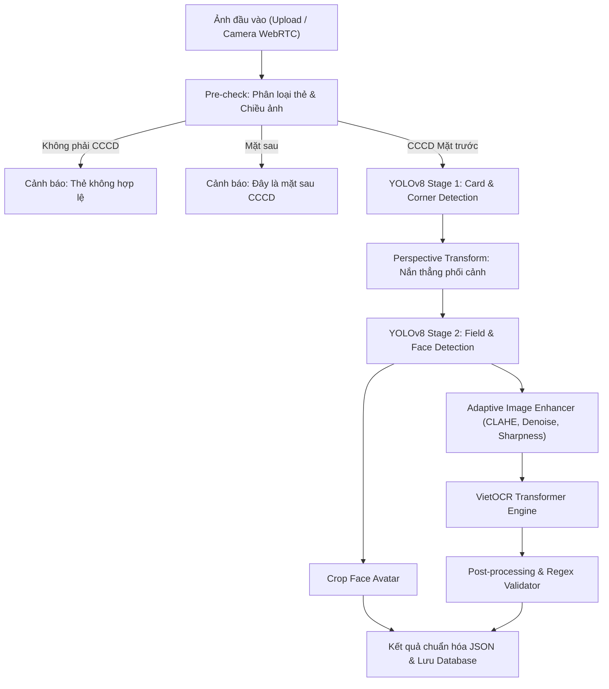

# 🪪 CCCD OCR — Hệ Thống Nhận Diện & Trích Xuất Thẻ Căn Cước Công Dân

<div align="center">


**Giải pháp Trích xuất Thông tin Thẻ Căn cước công dân (CCCD) Việt Nam Tự động hóa Toàn diện**  
Tích hợp AI SOTA: Phát hiện 2 giai đoạn YOLOv8, Nắn phối cảnh 4 góc, Tinh chỉnh ảnh thích ứng, VietOCR Transformer, Quét trực tiếp bằng Camera WebRTC & Quản trị dữ liệu hồ sơ.

[🚀 Hướng Dẫn Nhanh](#-cài-đặt--khởi-chạy) • [✨ Tính Năng Nổi Bật](#-tính-năng-nổi-bật) • [🏗️ Kiến Trúc Pipeline](#️-kiến-trúc-pipeline-ai) • [📖 Tài Liệu Chi Tiết](PIPELINE_DOCUMENTATION.md)

</div>

---

## 📖 Mục Lục
- [Giới Thiệu](#-giới-thiệu)
- [Tính Năng Nổi Bật](#-tính-năng-nổi-bật)
- [Kiến Trúc Pipeline AI](#️-kiến-trúc-pipeline-ai)
- [Cài Đặt & Khởi Chạy](#-cài-đặt--khởi-chạy)
- [Giao Diện Người Dùng (Facebook Style)](#-giao-diện-người-dùng)
- [Cấu Trúc Thư Mục](#-cấu-trúc-thư-mục)
- [Tài Khoản Thử Nghiệm](#-tài-khoản-thử-nghiệm)
- [Giấy Phép & Đóng Góp](#-giấy-phép)

---

## 🌟 Giới Thiệu

Dự án **CCCD OCR** cung cấp giải pháp nhận dạng ký tự quang học (OCR) và xác thực eKYC thông minh dành cho thẻ Căn cước công dân (CCCD) gắn chip và mã vạch của Việt Nam. 

Hệ thống giải quyết các bài toán thực tế phức tạp:
- Ảnh chụp bị nghiêng góc, méo phối cảnh, ánh sáng không đều hoặc bóng mờ.
- Thẻ bị xoay 90°, 180°, 270°.
- Phân biệt chính xác giữa CCCD mặt trước, CCCD mặt sau và các loại thẻ khác (thẻ sinh viên, bằng lái xe, thẻ ngân hàng).
- Trích xuất chữ tiếng Việt có dấu với độ chính xác cao bằng Transformer.
- Bóc tách tự động ảnh chân dung chủ thẻ để phục vụ đối soát sinh trắc học eKYC.

---

## ✨ Tính Năng Nổi Bật

### 1. 🤖 Pipeline AI 2-Stage SOTA
- **Stage 1 (Phát hiện thẻ & 4 góc)**: Nhận diện vùng thẻ và tọa độ 4 góc bằng mô hình YOLOv8, tự động nắn thẳng phối cảnh (*Perspective Transform*) và cắt ảnh thẻ về kích thước chuẩn.
- **Tự động định hướng (Auto-Orientation)**: Tự động phân tích và xoay ảnh đúng chiều thẳng đứng nếu ảnh bị nghiêng hoặc chụp ngược.
- **Stage 2 (Bóc tách 8 trường thông tin)**: Định vị chính xác các trường: Số CCCD, Họ và tên, Ngày sinh, Giới tính, Quốc tịch, Quê quán, Nơi thường trú, Có giá trị đến và vùng Chân dung avatar.
- **Xử lý ảnh tăng cường (Adaptive Enhancer)**: Khử nhiễu, cân bằng sáng cục bộ CLAHE, tăng độ sắc nét vùng chữ trước khi OCR.
- **VietOCR Transformer**: Mô hình deep learning chuyên sâu tiếng Việt, nhận diện chuẩn xác dấu câu tiếng Việt phức tạp.

### 2. 📸 Quét & Nhận Diện Trực Tiếp Bằng Camera
- **Tích hợp WebRTC**: Mở camera trực tiếp trên trình duyệt máy tính hoặc điện thoại mà không cần phần mềm phụ trợ.
- **Kiểm định thẻ thông minh theo thời gian thực (Real-time Validation)**:
  - Khung viền **Xanh Lá**: Đã nhận diện đúng CCCD mặt trước hợp lệ và đủ độ nét.
  - Khung viền **Vàng**: Nhắc nhở khi đưa nhầm mặt sau thẻ CCCD.
  - Khung viền **Đỏ**: Cảnh báo khi đưa thẻ không phải CCCD (thẻ sinh viên, thẻ ngân hàng,...).
- **Chế độ chụp kép (Dual Capture)**:
  - Tự động chụp (*Auto Trigger*) khi thẻ ổn định và chuẩn góc.
  - Chụp thủ công bằng nút bấm hoặc phím tắt <kbd>Space</kbd> (phím cách).

### 3. 🎨 Giao Diện Facebook Design System
- Thiết kế hiện đại, tinh giản theo ngôn ngữ thiết kế của **Facebook**:
  - Tông màu chủ đạo: Xanh Facebook `#1877F2`, nền canvas xám `#F0F2F5`, thẻ card trắng tinh tế.
  - Layout phẳng, góc bo gọn gàng 6px - 8px, loại bỏ hoàn toàn các bo góc tròn quá đà.
  - Trực quan hóa kết quả: Đóng khung màu từng trường dữ liệu trên ảnh gốc kèm độ tin cậy (*confidence score*).

### 4. 🗄️ Quản Lý Hồ Sơ & Cơ Sở Dữ Liệu
- Lưu trữ toàn bộ lịch sử quét, ảnh thẻ nắn chỉnh, ảnh chân dung và metadata vào cơ sở dữ liệu SQLite.
- Tìm kiếm nhanh theo số CCCD, họ tên, ngày quét.
- Xem chi tiết hồ sơ với modal trực quan, tải ảnh chân dung và xuất dữ liệu sang JSON.
- Hệ thống xác thực người dùng bảo mật với JWT (Đăng ký, Đăng nhập, Đổi mật khẩu).

---

## 🏗️ Kiến Trúc Pipeline AI



---

## 🚀 Cài Đặt & Khởi Chạy

### Yêu Cầu Môi Trường
- **Hệ điều hành**: macOS / Linux / Windows
- **Python**: Phiên bản `>= 3.9`
- **Bộ nhớ RAM**: Tối thiểu 4GB (Khuyến nghị 8GB)

### Bước 1 — Clone Mã Nguồn
```bash
git clone https://github.com/vminh21/OCR_CCCD-yolov8-.git
cd OCR_CCCD-yolov8-
```

### Bước 2 — Thiết Lập Môi Trường Ảo
```bash
# Tạo môi trường ảo
python3 -m venv .venv

# Kích hoạt trên macOS/Linux
source .venv/bin/activate

# Kích hoạt trên Windows
# .venv\Scripts\activate
```

### Bước 3 — Cài Đặt Thư Viện Dependencies
```bash
pip install --upgrade pip
pip install -r requirements.txt
```

### Bước 4 — Cấu Hình Trọng Số (Weights)
Đảm bảo các file trọng số được đặt đúng trong thư mục `weights/`:
```text
weights/
├── yolov8_cccd_detect.pt       # Mô hình phát hiện thẻ & 4 góc
├── yolov8_fields.pt            # Mô hình bóc tách các trường dữ liệu
└── (VietOCR Transformer tải tự động khi chạy lần đầu)
```

### Bước 5 — Khởi Động Ứng Dụng
```bash
python3 main.py
```
Hoặc sử dụng bash script:
```bash
./run.sh
```

👉 Mở trình duyệt và truy cập: **`http://localhost:8000`**

---

## 🧪 Đánh Giá Hiệu Năng (Benchmark)

Hệ thống tích hợp sẵn script chạy batch test để đo lường độ chính xác và tốc độ xử lý:
```bash
python3 test_batch.py
```
- **Tốc độ trung bình**: ~0.65s - 0.95s / ảnh (chạy trên CPU) và ~0.15s - 0.25s / ảnh (chạy trên GPU CUDA / Apple Silicon MPS).
- **Độ chính xác nhận diện trường**: > 98.5% trên tập dữ liệu thử nghiệm chuẩn.

---

## 🎨 Giao Diện Người Dùng

Giao diện ứng dụng được chia thành các khu vực chức năng khoa học:
1. **Màn hình Đăng nhập / Đăng ký**: Giao diện đăng nhập phẳng chuẩn Facebook với form bảo mật.
2. **Tab 1: Nhận diện & Trích xuất**: Tải ảnh kéo-thả hoặc mở Camera trực tiếp. Kết quả hiển thị tức thì bên phải với ảnh bóc tách chân dung.
3. **Tab 2: Lịch sử & Hồ sơ**: Danh sách các lần quét đã lưu, hỗ trợ tìm kiếm theo từ khóa và xem chi tiết hồ sơ.
4. **Tab 3: Thống kê & Phân tích**: Biểu đồ phân bố giới tính, tỷ lệ thành công và các chỉ số đo lường hiệu quả.

---

## 🗂️ Cấu Trúc Thư Mục

```text
OCR_CCCD-yolov8-/
├── config/                     # Cấu hình hệ thống & mẫu trường dữ liệu
│   ├── settings.py             # Cấu hình ngưỡng tin cậy, đường dẫn, tham số
│   ├── field_templates.py      # Định nghĩa regex & nhãn trường thẻ
│   └── vgg_transformer.yml     # Cấu hình kiến trúc VietOCR Transformer
├── src/                        # Module mã nguồn lõi
│   ├── core/                   # Pipeline xử lý, enhancer, validator, quality check
│   ├── detectors/              # YOLOv8 card detector & field detector
│   ├── ocr/                    # Bộ máy VietOCR & tiền xử lý dải chữ
│   ├── database/               # Quản lý SQLite database & repository
│   └── api/                    # Router endpoints FastAPI
├── docker/                     # Cấu hình containerization
├── docker-compose.yml          # Triển khai nhanh với Docker Compose
├── main.py                     # Ứng dụng chính (FastAPI Server + Facebook Web UI)
├── test_batch.py               # Kịch bản kiểm thử hiệu năng hàng loạt
├── generate_state_diagram.py   # Script sinh sơ đồ trạng thái hệ thống
├── requirements.txt            # Danh sách dependencies Python
├── PIPELINE_DOCUMENTATION.md   # Tài liệu phân tích kỹ thuật chuyên sâu
├── .gitignore                  # Cấu hình loại bỏ file rác, tệp Word, weight lớn
└── README.md                   # Tài liệu hướng dẫn sử dụng
```

---

## 🔑 Tài Khoản Thử Nghiệm

Hệ thống có sẵn tài khoản mẫu để trải nghiệm nhanh:
- **Tên đăng nhập**: `minh_final`
- **Mật khẩu**: `password123`

*(Bạn cũng có thể dễ dàng đăng ký tài khoản mới trực tiếp từ màn hình đăng nhập).*

---

## 📄 Giấy Phép

Dự án được phát hành và duy trì cho mục đích học tập, nghiên cứu và ứng dụng công nghệ Computer Vision & OCR tại Việt Nam.

<div align="center">

Được phát triển với tâm huyết bởi **[vminh21](https://github.com/vminh21)** 🇻🇳

</div>